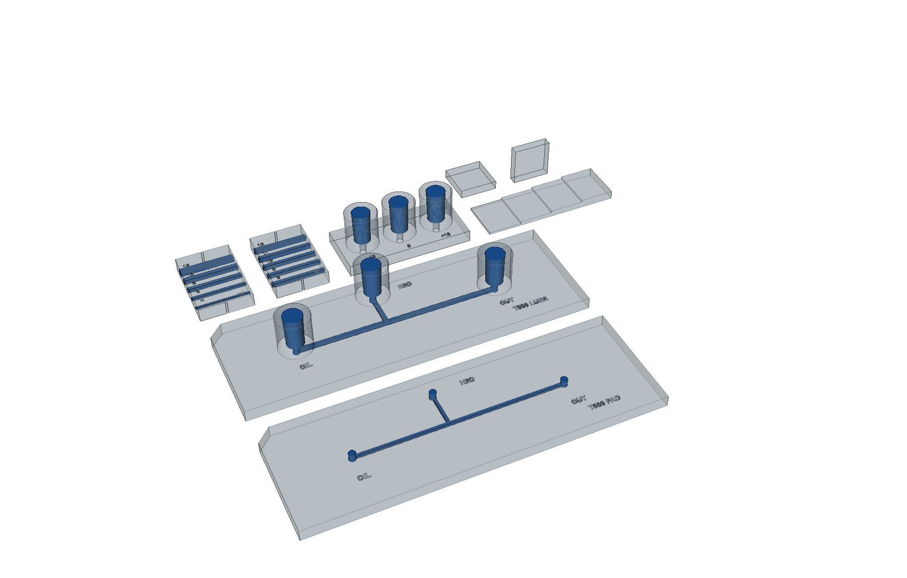

# Resin print test plate

One print job that decides whether a **monolithic resin-printed chip** can
replace the milled PMMA + 468MP one. Designed for the Formlabs Form Studio 1
(MSLA, 35 µm XY pixel) in **Alpha Clear**, about 15 mL of resin.



*Translucent bodies, channels and sockets in blue. Front to back: T600 (pads),
T800 (printed Luers); W and H channel bars, Luer fit gauge; θ coupons and the
optical step wedge.*

## Why print at all

Printing removes the largest open unknown in the milled design. A monolithic
chip has the **same material on floor, walls and ceiling**, so the
PMMA-floor / 468MP-ceiling wetting mismatch — which no simulation here could
reach, because the 3D case's symmetry plane forces the two equal — simply
goes away. Bonding, leak paths and the separate Luer mounts go with it.

In exchange it raises four new questions: whether enclosed channels print to
size, whether they drain, whether the printed surface is oil-wet enough, and
whether you can image through it. Each coupon answers one of them.

## Coupons

| Coupon | Tests | Measure | Go if |
|---|---|---|---|
| **W** | channel *width*, 400–1200 µm nominal square, open both ends | Saw across at the side notches; photograph sections against a scale | 600/800 within ±1 px (±35 µm). The smallest that drains sets your floor |
| **H** | channel *height* — ceiling over-cure — at 800 µm wide, 800–1200 µm tall | Same section | Read off which nominal height prints as 800 µm: that difference is your Z compensation |
| **T600 PAD** | printed twin of the v2 milled chip, flat 1.5 mm ports for your existing surface-mount Luers | Flush with IPA by syringe; flow-test at the operating head | Drains fully; no leaks |
| **T800 LUER** | same layout at 800 µm with female Luer sockets printed in | As above, using the sockets | As above, and sockets seal |
| **LUER** | three sockets identical to T800's, opening Ø −0.10 / 0 / +0.10 mm | Push a syringe tip into each | The offset that seats firmly and holds a push without leaking — use it on the chip |
| **THF** | θ on a vat-cured layer face, like a channel **floor** | Sessile drop under doped oil, in a 10 mm cuvette | θ ≥ 130° (cliff is 105–120°, `wetting_2026-08`) |
| **THV** | θ on stacked layer edges, like a channel **side wall**. Print standing; test lying on its side | As THF | As THF |
| **OPT** | optical path, 0.5 / 1.0 / 1.5 / 2.0 mm (2.0 = floor + ceiling of a chip) | Backlight + strobe; image a razor edge through each step | Edge blur ≤ 1–2 px at your 5–10 µm/px |

All the numbers are in [`measurement_sheet.csv`](measurement_sheet.csv), with
empty columns to fill in.

**What no coupon can test:** the over-cured channel *ceiling* as a wetting
surface — it can't be exposed without cutting. Judge its roughness from the
H sections.

## Printing

- **Flat, floor-down, directly on the build platform, no supports.** This is
  the orientation a planar chip uses. PreForm will want to angle and support
  everything; override it. THV is the one exception: it prints standing.
- **Alpha Clear at 100 µm.** Every Z dimension is a multiple of 100 µm, so no
  feature lands between layers.
- **Flush channels by syringe with IPA *before* curing.** A wash bath won't
  push resin out of a 45 mm enclosed channel, and anything left inside cures
  solid in the Wash+Cure.

### What to expect

- **Ceiling over-cure.** In bottom-up MSLA the layers that close a channel
  cure with liquid resin trapped *above* the cure plane, and unabsorbed light
  keeps going into it. Over-cure therefore grows down from the ceiling and
  shrinks channel height. A clear resin carries the least UV absorber, so it
  is the worst case. That is what H measures.
- **Pixel quantisation.** 800 µm is 22.9 px; 600 is 17.1. Expect ±1 px.
- **The platform face is rough.** First layers are over-exposed for
  adhesion, and that face is the outside of every chip floor — so it is in
  your optical path. OPT is printed the same way, so it captures this.

## Design notes

- **T-chip coordinates are imported** from `../gen_guide_diagrams.py`, so the
  printed twin follows the v2 drawing if it changes.
- **The T-chips are the v2 drawing as drawn: 20 mm approach, 25 mm outlet,
  45 mm of enclosed oil path.** That is the hard drainage case on purpose — if
  it drains, anything shorter will. It also means these chips carry ~70% of
  the system's flow resistance, and with the BOM's resistor tubing they come
  to **~2.7–2.9× the resistance the simulations assume**: the tubing was sized
  for the simulation's short 2 mm / 4 mm chip, not this drawing. Expect to
  need roughly 2.7× the plan's head for the design flow — so leak-test at
  ≥ 30 cm of water, not 10.
- **Luer sockets are slip, not lock.** ISO 80369-7 / 594-1 female: opening
  4.270–4.315 mm (4.2925 used), 6% taper on diameter, ≥ 7.5 mm deep. A
  nominal 3.925 mm male tip seats about 6.1 mm in. Checked against the
  standard's taper to within 1 µm at four depths. The dimensions come from
  secondary sources and the 2021 edition of ISO 80369-7 wasn't checked
  directly — trust the LUER gauge over the spec.

## Regenerating

```bash
uv run gen_print_test_plate.py
```

`uv` fetches CadQuery from the script's inline dependencies; no other setup
is needed. The script checks its own output and exits non-zero on failure:

- every solid valid
- **no sealed internal cavity** — in a resin print that is trapped liquid
  resin that can never drain. The check is negative-controlled: an enclosed
  pocket and a capped channel each read 1.
- every W and H channel sections back to its nominal width, height and
  floor height
